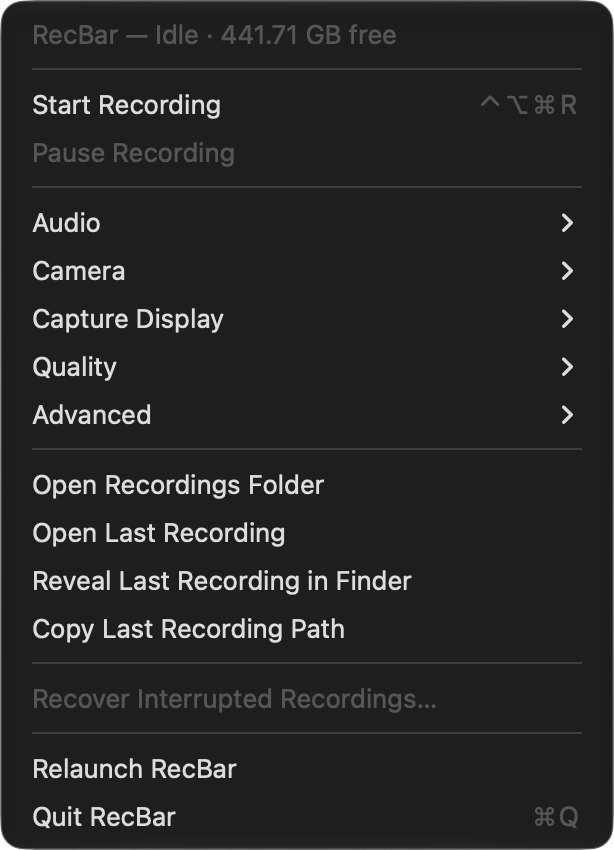
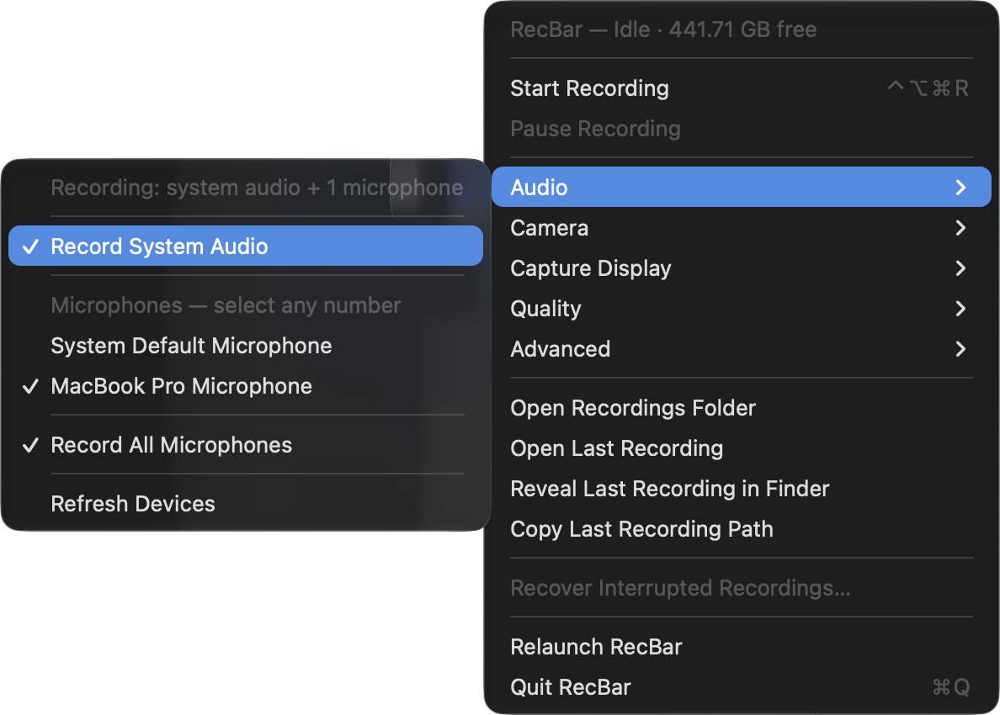
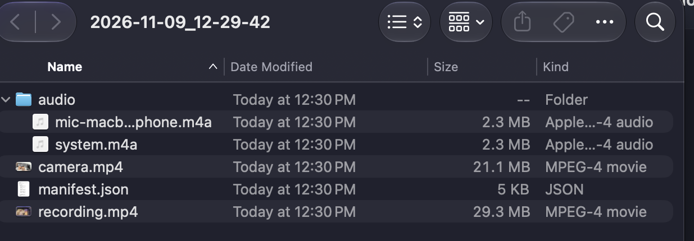

<p align="center">
  
</p>

<h1 align="center">RecBar</h1>

<p align="center">A fast, native macOS menu-bar screen recorder with real multi-track audio and crash-safe output.</p>

RecBar records your screen with hardware-encoded HEVC and writes **every audio source to its own track**: the Mac's system audio, plus each selected microphone (built-in, Blue Yeti, or several at once). The webcam is captured as a separate file with microphones only. Everything is written progressively in 30-second crash-safe segments and merged losslessly when you stop, so a crash never costs more than the segment in progress.

No OBS. No cloud. No giant QuickTime capture file.

---

## Screenshots








## What it produces

A session folder under `~/Movies/RecBar/`:

```
2026-11-09_12-29-42/
├── recording.mp4                       # screen + system audio + every microphone
├── camera.mp4                          # webcam + every microphone (no system audio)
├── audio/
│   ├── system.m4a                      # standalone backup, stereo
│   └── mic-macbook-pro-microphone.m4a  # standalone backup, mono
├── manifest.json                       # settings, tracks, segments, status, notes
└── segments/                           # only when "Keep Segment Files" is on
    ├── screen-00001.mp4                # video-only crash-safe chunks
    ├── camera-00001.mp4
    └── audio/segments/
        ├── system-00001.m4a
        └── mic-macbook-pro-microphone-00001.m4a
```

### Track layout

| File | Video | Audio tracks |
|---|---|---|
| `recording.mp4` | HEVC, 1080p30 (Compact) or native | **System audio** (stereo) + **one track per microphone** (mono) |
| `camera.mp4` | HEVC 720p30 | **One track per microphone** (mono), never system audio |
| `audio/system.m4a` | — | System audio, stereo |
| `audio/mic-<name>.m4a` | — | One microphone, mono |

Track order is stable: system audio first, then microphones in selection order. Track IDs are `system` and `mic-<slug>`, so an editor or agent can address them without guessing.

### Size

One hour in the default Compact preset:

| Source | Codec | Bitrate | Size / hour |
|---|---|---|---|
| Screen | HEVC hardware | 3.2 Mbps | ~1.4 GB |
| System audio | AAC-LC 48 kHz stereo | 256 kbps | ~115 MB |
| Each microphone | AAC-LC 48 kHz mono | 256 kbps | ~115 MB |
| Webcam (optional) | HEVC 720p30 | 2 Mbps | ~0.9 GB |

A one-hour screen + voiceover with system audio is about **1.6 GB**. The Balanced and Crisp presets record at native resolution and frame rate for sharper text.

## Audio routing

- **Audio → Record System Audio** captures what the Mac is playing as a stereo track.
- **Audio → Microphones** is a multi-select list. Select the built-in mic, a USB mic, or both; each gets its own writer, its own segment chain, and its own track in both final files.
- **System Default Microphone** records whichever input macOS currently considers default.
- **Record All Microphones** selects every connected input at once, for backup tracks.
- **Refresh Devices** re-scans after plugging in a USB interface.

The screen recording always gets system audio plus every selected mic. The camera file gets the same microphones but **never** system audio, so a talking-head file does not contain music or notifications from the desktop.

If system audio cannot start, RecBar keeps recording the screen and mics and shows a notice instead of failing the session. The same is true for a camera or microphone that disappears mid-recording.

## Crash safety

Every source writes its own chain of short files:

1. `AVAssetWriter` writes to `<name>.partial.mp4` (video) or `<name>.partial.m4a` (audio).
2. On rotation, `finishWriting` completes, the file is **fsync'd**, renamed atomically to its final name, and the directory is fsync'd.
3. `manifest.json` is rewritten atomically and fsync'd after every segment.
4. All writers rotate at the same logical instant, so video and audio boundaries stay aligned across pause/resume.

A hard crash loses **at most the current 30-second segment per source**. Everything finalized before that is a valid, playable file.

On the next launch RecBar scans for unfinished sessions, offers to recover them, and:

- unions the manifest's segment list with the files actually on disk (a crash can land between the atomic rename and the manifest write),
- merges the video segments and every audio chain with AVFoundation passthrough (no re-encode),
- writes `recording.mp4`, `camera.mp4`, and the standalone `audio/*.m4a` files,
- marks the manifest `recovered` and records which in-progress segment was lost.

This path is exercised live: SIGKILL during a recording, relaunch, recover. The recovered screen file had one video track plus two audio tracks (system + mic), the camera file had one video track plus one mic track, and the standalone audio files were present.

## Screen Recording permission

The repeated "Screen Recording permission is required" prompt was a signing problem, not a TCC bug. macOS keys the grant to the app's **designated requirement**; a default ad-hoc signature uses the cdhash, which changes on every rebuild.

RecBar now signs with a stable requirement:

```
designated => identifier "app.recbar.recorder"
```

That keeps the grant across rebuilds and relaunches. In addition:

- `CGRequestScreenCaptureAccess()` is called **at most once per install** (`RecBarDidRequestScreenCapture` in `UserDefaults`).
- After that, a denied start shows an alert with **Open Settings**, **Relaunch RecBar**, and **Cancel**.
- **Relaunch RecBar** is there because macOS only applies a newly granted Screen Recording permission to a process started after the grant.

Verified on this Mac: grant once, rebuild, reinstall, relaunch several times, record again — no repeat prompt.

## Build and install

Requirements: macOS 15+ (built and tested on macOS 27.0.1), Apple Silicon, Command Line Tools. Full Xcode is not required.

```bash
cd RecBar
./scripts/build_app.sh      # release build, bundle, stable ad-hoc signature -> dist/RecBar.app
./scripts/install.sh        # copy to /Applications and launch
```

Or drag `dist/RecBar.app` into `/Applications` yourself.

The build script prints the designated requirement so you can confirm it:

```
designated => identifier "app.recbar.recorder"
```

The app is ad-hoc signed for local use. Distributing to other Macs still requires a Developer ID signature and notarization.

## First run

1. Launch RecBar. It appears as a **record icon in the menu bar** (no Dock icon).
2. Grant **Screen Recording** when macOS asks, then click **Relaunch RecBar** in the alert (or quit and reopen it).
3. Open the menu and choose **Audio** to enable system audio and select microphones.
4. Choose **Start Recording**. macOS asks for **Microphone** and **Camera** access the first time; grant them to include voice and the webcam file.
5. Stop with **Stop & Save Recording**. The session appears in `~/Movies/RecBar/`.

## Menu bar

- **Start Recording / Stop & Save Recording** — `⌃⌥⌘R`
- **Pause Recording / Resume Recording** — `⌃⌥⌘P` (pausing stops capture entirely, so it costs no CPU)
- **Audio** — system audio toggle, multi-select microphones, system default, record all, refresh
- **Camera** — webcam as a separate 720p file, or off
- **Capture Display** — choose a monitor
- **Quality** — Compact 1080p30, Balanced Native 30, Crisp Native 60
- **Advanced** — keep segment files, show cursor, launch at login
- **Open Recordings Folder / Open Last Recording / Reveal / Copy Path**
- **Recover Interrupted Recordings…**
- **Relaunch RecBar / Quit RecBar**

While recording, the menu-bar icon turns red and shows a live timer and size. While merging, it shows progress.

## Headless self-tests

No screen, microphone, or camera permission needed:

```bash
.build/release/RecBar --selftest
.build/release/RecBar --selftest-recovery
```

`--selftest` generates four seconds of synthetic video plus two independent audio sources, writes one-second segments for screen, camera, system audio, and mic, merges them, and asserts the exact track layout:

```
SELFTEST segments: screen=4 camera=4 systemAudio=4 mic=4
SELFTEST merged screen: duration=4.00s tracks=v1/a2 bytes=297969
SELFTEST merged camera: duration=4.00s tracks=v1/a1 bytes=170963
SELFTEST standalone audio system: duration=4.00s tracks=1 bytes=106456 path=system.m4a
SELFTEST standalone audio mic-test: duration=4.00s tracks=1 bytes=121822 path=mic-test.m4a
SELFTEST PASS
```

`--selftest-recovery` writes three segments per track, records only the first two in the manifest (simulating a crash between the atomic rename and the manifest write), adds stale partial files, then scans and recovers the session:

```
SELFTEST-RECOVERY scan: screen=3 camera=3 audioTracks=2
SELFTEST-RECOVERY merged screen: duration=3.00s tracks=v1/a2 bytes=109322
SELFTEST-RECOVERY merged camera: duration=3.00s tracks=v1/a1 bytes=45273
SELFTEST-RECOVERY PASS
```

## Architecture

```
ScreenCaptureKit (video) ──> SegmentWriter(screen) ──────┐
ScreenCaptureKit (audio) ──> AudioTrackWriter(system) ───┤
AVCapture microphone 1 ────> AudioTrackWriter(mic-1) ────┼─> ManifestStore (atomic JSON)
AVCapture microphone N ────> AudioTrackWriter(mic-N) ────┤
AVCapture camera ──────────> SegmentWriter(camera) ──────┘
                                                          └─> MergeService (multi-track passthrough)
```

- `ScreenCaptureEngine` — ScreenCaptureKit display capture plus a separate system-audio stream.
- `AudioCaptureEngine` — one AVCaptureSession per selected microphone.
- `CameraCaptureEngine` — AVCaptureSession webcam capture, mirrored, 720p.
- `SegmentWriter` — video-only HEVC segments with controller-driven rotation, fsync, atomic rename.
- `AudioTrackWriter` — one crash-safe AAC segment chain per audio source.
- `ManifestStore` — thread-safe, atomic, fsync'd session manifest.
- `MergeService` — AVMutableComposition + passthrough export; composes multi-track video and standalone audio, with an ffmpeg stream-copy fallback.
- `RecoveryService` — scans interrupted sessions, unions manifest with disk, rebuilds all tracks.
- `RecorderController` — start/pause/resume/stop, synchronized rotation, disk guard, auto-stop below 5 GB.
- Menu bar UI — AppKit `NSStatusItem`, Carbon global hotkeys.

## Limits

- Records a **display**, not a single window.
- A hard crash loses at most the current 30-second segment per source; that window is configurable in `RecorderSettings.segmentSeconds`.
- System audio is captured through ScreenCaptureKit; DRM-protected playback may be silent, which is a macOS limitation.
- Ad-hoc signing is for local use. Other Macs need Developer ID signing and notarization.
- Each additional microphone adds about 115 MB per hour.

## Troubleshooting

**Menu bar icon missing** — RecBar is an accessory app (`LSUIElement`); check the menu bar, not the Dock. Quit and relaunch if needed.

**Permission alert even though the toggle is on** — click **Relaunch RecBar** in the alert. macOS does not apply a new Screen Recording grant to the running process.

**Microphone not listed** — connect it, then use **Audio → Refresh Devices**. USB audio devices sometimes take a second to appear.

**System audio is silent** — check the Mac's output device and whether the app you are recording uses DRM-protected playback. The system-audio track is separate from the mic track; open `audio/system.m4a` to inspect it directly.

**Merge failed** — the segments are kept and the manifest is marked `failed`. Use **Recover Interrupted Recordings…** on the next launch; `segments/` contains valid chunks.

**Disk fills up** — RecBar warns below 15 GB and stops/saves automatically below 5 GB.

## Privacy

Recordings stay on your Mac under `~/Movies/RecBar/`. RecBar has no network code and no telemetry.
